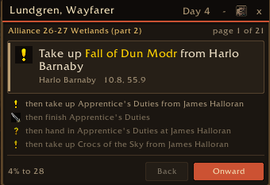
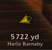
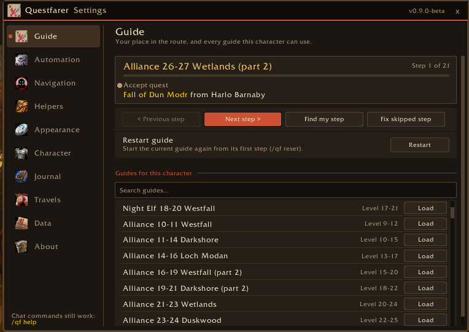
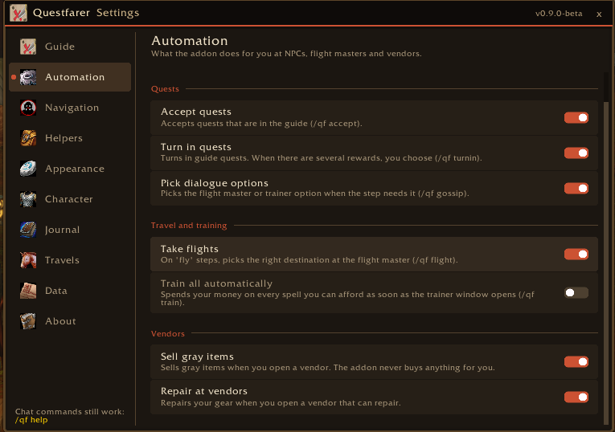
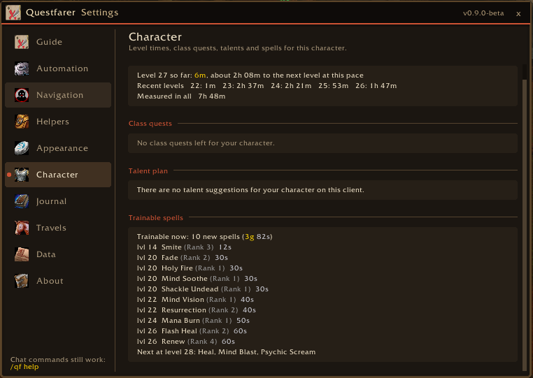

# Questfarer

A free step-by-step 1-60 leveling guide addon for **WoW Forever** (interface 16001), for Alliance and Horde.
It shows one step at a time, accepts and turns in quests for you, and moves on by itself when a step is done.

It is not a speedleveling guide. Questfarer is made for relaxed, no-brain leveling: it skips escort quests that are
too hard solo and quests deep inside caves, marks elite quests as optional, and keeps the route easy to follow
instead of squeezing out every minute.

**Beta (0.9.2-beta).** The routes are checked against the quest data and simulated, but not fully played
through yet. Reports of wrong steps help a lot.

  
  

  
  
  

## Download

Install it with the CurseForge app from [CurseForge](https://www.curseforge.com/wow/addons/questfarer), or get the
newest zip from [Releases](https://github.com/slimbozs/Questfarer/releases).

1. Close the game.
2. Unzip it and put the `Questfarer` folder in `World of Warcraft\_forever_\Interface\AddOns\`
   (the folder name of your game version may differ).
3. Start the game and check that Questfarer is turned on in the AddOns list.

Everything about using the addon is in [Questfarer/README.md](Questfarer/README.md).

## What is in this repository

- `Questfarer/`: the addon itself.
- `Tools/`: the route files and the Python scripts that build the guides in `Questfarer/Guides/`. Never edit the
  generated guides by hand; change `Tools/routes/*.route` and run `python Tools/build_guides.py`.
  See [Tools/README.md](Tools/README.md).

## Problems and ideas

Join the [Questfarer Discord](https://discord.gg/nqBc8HEcpW) (`#help`, `#bug-reports`, `#suggestions`), or use
**Issues > New issue** here. "Wrong step or bug" is for a step that is wrong or an error in game,
"Data contribution" is for the export text from the addon's Data page.

## Support

Questfarer is free and always will be. If it saves you time and you want to say thanks, you can leave a tip on
[Ko-fi](https://ko-fi.com/orfstudio).

## License and credits

GPLv3, see [LICENSE.md](LICENSE.md). Quest, NPC, object and item data comes from
[QuestieDB](https://github.com/Questie/QuestieDB) under the GPLv3 terms it allows. Questfarer is not made by or
affiliated with the Questie team. Class spell lists come from
[What's Training?](https://www.curseforge.com/wow/addons/whats-training) by Sveng (MIT).

Made by ORF Studio.
